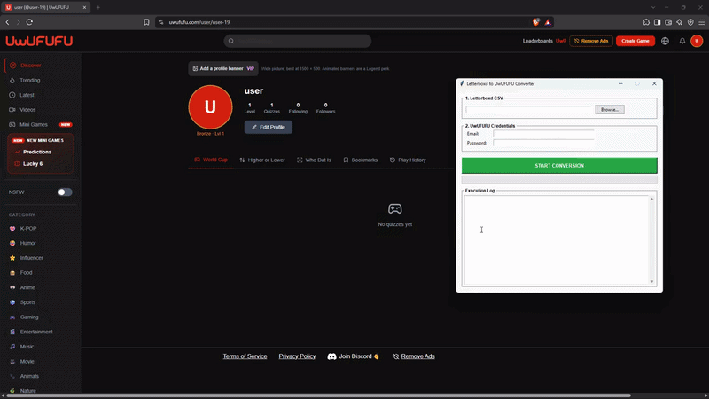

# Letterboxd to UwUFUFU Converter

An open-source Python tool that automatically converts your Letterboxd watched movies diary into an interactive worldcup bracket tournament on UwUFUFU.



## Installation & Usage (Desktop GUI)

### Option A: Use the Pre-built Executable (Recommended)
1. Head over to the **Releases** section of this repository.
2. Download the latest executable file.
3. Double-click to launch the application.

After the tournament is created on UwUFUFU, open it, click **Edit**, and then publish it.

To cancel a running conversion, click **Stop**. If the draft tournament was already created, it stays on UwUFUFU with the posters uploaded so far.

Movies whose poster can't be found are left out of the tournament. They are listed at the end of the **Activity** log so you can add them manually when you edit the tournament.

#### Choosing and combining CSV files
Click **Add CSV** to add Letterboxd CSV files to the **Files** list (you can pick several at once). New files start unselected: tick the ones you want in the tournament, or use **Select all**. Only the selected files are used, so you can keep several exports in the list and pick a different combination each time.

Each file shows the Letterboxd account it belongs to, taken from the name of the folder a Letterboxd export unzips to (`letterboxd-<username>-<date>-utc`). Files saved anywhere else show `Letterboxd account: unknown`.

When two or more files are selected, choose how to combine them under **Settings**:
- **Union**: every unique movie found in at least one selected file.
- **Intersection**: only the movies present in all the selected files.

Movies are matched by title and year, and each movie appears only once in the tournament.

### Option B: Run from Source Code
If you want to run or modify the source code locally, you will need your own TMDb API key.
1. Clone the repository:

   ```bash
   git clone https://github.com/francescoluca/letterboxd-to-uwufufu
   cd letterboxd-to-uwufufu
   ```

2. Set up your environment and install dependencies:

   ```bash
   python3 -m venv venv
   source venv/bin/activate
   pip install -r requirements.txt
   ```
3. Configure your TMDb API Key. Create a file named config.py inside the src/ directory and add your v3 API key:
   ```bash
   # src/config.py
   TMDB_API_KEY = "your_api_key"
   ```
4. Run the application:

   ```bash
   python main.py
   ```
   
## Looking for the CLI version?

If you prefer using the command-line interface (CLI) version of this tool, please check out **v0.1.0** under the **Releases** section of this repository.

## Find a bug?

If you found an issue or would like to submit an improvement to this project, please submit an issue using the **Issues** tab.

## Disclaimer

This tool is a personal open-source side-project. It is not affiliated with, endorsed by, or supported by Letterboxd or UwUFUFU. Use responsibly and respect API rate limits.

## License

Distributed under the MIT License. See [LICENSE](LICENSE) for more information.
